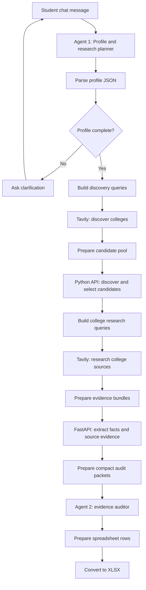

# EduCompass — Agentic AI MBA College Recommender

EduCompass is a student-focused AI project that helps graduates discover and compare MBA programmes in India. It collects a student's academic background, entrance-exam performance, budget, location preferences and career goals, researches potential colleges, checks source evidence, and prepares a personalized college-comparison spreadsheet.

> **Project status:** Prototype / academic project. The n8n export is saved as an inactive workflow and needs local credentials and backend configuration before it can run. The end-to-end ranking-to-Excel handoff must be tested before describing the generated recommendations as production-verified.

## Problem statement

Students often do not know which MBA colleges are realistic or suitable for them. College information is spread across official websites, regulators, ranking organisations and third-party education portals. The same college may publish programme-specific and institution-wide placement figures, while cutoff information can differ by exam and year. Comparing these details manually is time-consuming and can lead to decisions based on incomplete or mismatched information.

EduCompass aims to close that information gap by turning a student's profile and goals into a structured, source-linked comparison of relevant MBA programmes.

## Purpose

The project is designed to:

- collect the information required to personalise college suggestions;
- ask follow-up questions when required profile details are missing;
- discover candidate colleges based on the student's target programme and preferences;
- research admissions, fees, cutoffs, placements, curriculum and related factors;
- preserve source links and distinguish official data from third-party estimates;
- reject evidence that refers to the wrong institution, programme, exam or year;
- compare colleges against the student's priorities instead of relying on a generic ranking; and
- create an Excel file that students can use to make an informed shortlist.

## How it works



### Agent 1 — Student Profile & Research Planner

- **Model in the workflow export:** OpenAI Chat Model using `gpt-5-mini`.
- Extracts the student's explicitly provided information into structured JSON.
- Uses n8n Simple Memory to support multi-turn clarification within a chat session.
- Identifies missing information and asks the student for it before discovery continues.
- It should not invent exam scores, career goals, locations or budget values.

### Agent 2 — Evidence Auditor

- **Model in the workflow export:** Ollama `llama3.2:3b`.
- Receives a compact evidence packet rather than the full Tavily response dump.
- Checks institution and programme identity, cutoff exam/year, placement scope and conflicting sources.
- It is not intended to browse, invent data, calculate ROI or perform the final numerical ranking.
- Python should remain responsible for deterministic calculations and sorting.

## Technology stack

| Technology | Role in EduCompass |
|---|---|
| **n8n** | Orchestrates the workflow, API calls, branching, memory and file generation. |
| **OpenAI `gpt-5-mini`** | Extracts the student's profile and identifies missing information (Agent 1). |
| **Ollama `llama3.2:3b`** | Runs the lightweight evidence-auditing agent locally (Agent 2). |
| **Tavily Search API** | Searches the web for candidate colleges and programme evidence. |
| **Python** | Normalises candidates, validates and extracts evidence, and supports fit/ranking logic. |
| **FastAPI** | Exposes the Python backend to n8n through HTTP endpoints. |
| **SQLite** | Lightweight persistence for institutions, programmes, sources, evidence and community signals. |
| **JavaScript** | Data transformation and preparation in n8n Code nodes. |
| **Excel / XLSX** | The intended final student-facing college comparison output. |

## Student profile requirements

The profile schema currently used by the workflow includes the following fields. Some details may be optional in a specific execution, but the more complete the profile, the more useful the recommendations.

| Field | Example | Why it matters |
|---|---|---|
| Undergraduate degree | B.Tech | Academic background and eligibility context. |
| Undergraduate discipline | Information Technology | Helps identify relevant programmes and career alignment. |
| UG score and score type | 8.4 CGPA | Academic-profile context; the scale must be clear. |
| UG completion year | 2026 | Establishes graduation status and application context. |
| MBA specialisation | Business Analytics | Defines the target programme area. |
| Preferred locations | Pune, Bangalore | Personalises geographic fit. The student can instead say “Anywhere in India.” |
| Budget | ₹14 lakh maximum | Supports fee and affordability comparison. |
| Entrance exam(s) | CAT | Determines accepted-exam compatibility. |
| Exam status | Taken / planned / result pending | Determines whether a result is expected or required. |
| Exam year and score/percentile | CAT 2025, 92 percentile | Needed for admission-competitiveness comparisons when an exam has been taken and the result is known. |
| Exam flexibility | Exclusive / preferred / open | Distinguishes an exam-only restriction from a preference. |
| Career goal | Business Analyst | Connects programme content and outcomes to the student's goal. |
| Priorities | Placement, ROI, career fit | Personalises the relative importance of decision factors. |
| Study mode / work experience | Full-time campus / 0 months | Useful for separating full-time campus MBAs from work-integrated, online or part-time options. These fields are part of the intended enhanced profile contract and should be verified against the deployed Agent 1 prompt. |

**Input-handling rules:** A planned exam does not need a score. A taken exam with no score or percentile should trigger a clarification. A percentile must be in the 0–100 range. The workflow should not guess a missing value or convert a raw score to a percentile without a reliable, year-specific mapping. Contradictory values should be clarified unless the student explicitly corrects an earlier statement.

## Research and evidence policy

EduCompass is designed to prioritise sources in this order:

1. **Official programme and institution sources** — course pages, admission policy, fee structure and placement reports.
2. **Government and regulator sources** — such as NIRF, UGC and AICTE where relevant.
3. **Accreditors** — such as NBA, AACSB, AMBA or EQUIS/EFMD, where applicable.
4. **Reputable secondary education sources** — for example CollegeDunia, Careers360, Shiksha and MBAUniverse when official information is unavailable.
5. **Student/community feedback** — useful for context and lived experience, but not a substitute for official fees, placement percentages or cutoffs.

Every extracted fact should retain its URL, source type, year/context and scope where possible. A page on a third-party website is not automatically valid: the page must refer to the correct college and, where available, the correct programme.

### Handling missing or conflicting data

- Prefer official information when it directly answers the field.
- Use a third-party figure as a clearly labelled secondary estimate when appropriate; do not present it as official.
- Preserve the exam and year for each cutoff. Cutoffs for CAT, XAT, SNAP, CMAT, NMAT and other exams are not interchangeable.
- Distinguish programme-specific placement figures from institution-wide or school-wide results.
- Do not confuse the highest package with the average or median package.
- Do not interpret “placement assistance” as a placement percentage.
- When no sufficiently reliable evidence is found, mark the field as **Not verified in researched sources** rather than inventing a value.
- ROI should be calculated only when fee and salary inputs have compatible scope and are supported by evidence. An average-package-to-fee ratio is a comparison indicator, not a guarantee of payback or personal salary.

## Planned student-facing Excel

The comparison spreadsheet is intended to include these main columns:

- Rank and college/university
- MBA programme and location
- College brand value / reputation
- Entrance exams accepted
- 2025 cutoff — exam and percentile
- 2024 cutoff — exam and percentile
- Total MBA fees
- Average and median placement packages
- Placement percentage
- Top recruiting companies
- Specialisations offered
- Curriculum / course quality
- Eligibility and admission criteria
- Reservation / category benefits where relevant
- Nearby IT, business or technology hub
- ROI (fees versus placement)
- Personalised fit / career fit
- Key reason or caution
- Data confidence and source URLs

The export includes a `PREPARE — EXCEL ROWS` node and an XLSX conversion node. Before using it as a final recommendation, test that the upstream result contains a validated `top_10` list in the schema expected by the Excel-row node, and that the ranking stage is connected. Do not present a raw or unranked research list as the final ranked recommendation.

## Workflow nodes

The exported workflow includes these main nodes:

| Node | Function |
|---|---|
| `When chat message received` | Starts a chat execution. |
| `AGENT 1 — Profile & Research Planner` | Extracts the profile and asks clarifying questions when needed. |
| `PARSE — AGENT 1 OUTPUT1` | Parses the agent's JSON output. |
| `CHECK — MBA PROFILE COMPLETE?` | Routes complete profiles to discovery and incomplete profiles to clarification. |
| `ASK — CLARIFICATION` | Returns follow-up questions to the student. |
| `BUILD — DISCOVERY QUERIES` | Creates search queries from the profile. |
| `WEB SEARCH — CANDIDATE DISCOVERY` | Calls Tavily to discover possible colleges. |
| `PREPARE — CANDIDATE POOL` | Aggregates and deduplicates search results. |
| `PYTHON — DISCOVER & SELECT` | Calls the Python backend to select research candidates. |
| `BUILD — COLLEGE RESEARCH QUERIES` | Creates official-admission, official-quality/placement and third-party research queries. |
| `TAVILY — COLLEGE RESEARCH` | Retrieves detailed college evidence. |
| `PREPARE — VERIFIED EVIDENCE` | Associates Tavily responses with college metadata and groups evidence. |
| `PYTHON — EXTRACT FACTS` | Calls the FastAPI evidence extraction endpoint. |
| `PREPARE — AGENT 2 AUDIT PACKET` | Compacts evidence for the auditor. |
| `AGENT 2 — EVIDENCE AUDITOR` | Checks evidence quality and flags unsupported/conflicting facts. |
| `PREPARE — EXCEL ROWS` | Maps ranked college data to spreadsheet columns. |
| `EduCompass_MBA_Business_Analytics_Top10.xlsx` | Converts row items to an XLSX file. |

A `TOOL — READ PDF` helper is present in the export but is not connected to the main execution path shown in the exported connections.

## Backend layout

The backend is organised around a FastAPI application and service modules. The working project structure has included:

```text
backend/
├── app/
│   ├── main.py
│   ├── database.py
│   └── services/
│       ├── candidate_discovery.py
│       ├── evidence_service.py
│       ├── fact_extractor.py
│       ├── fit_engine.py
│       ├── pdf_reader.py
│       ├── report_generator.py
│       └── verification_service.py
├── data/
│   └── educompass.db
└── reports/
```

SQLite tables used by the project include `institutions`, `programs`, `sources`, `evidence` and `community_signals`.

## Setup

### 1. Requirements

- Python 3.11 or compatible version
- Node.js/npm if you run n8n locally through npm; Docker is also an option
- n8n with the AI Agent, OpenAI, Ollama, HTTP Request, Code, IF, Set and Convert to File nodes available
- An OpenAI API credential for Agent 1
- A Tavily API key for web search
- Ollama installed locally with the `llama3.2:3b` model available

### 2. Set up the Python backend

From the backend directory:

```powershell
cd backend
python -m venv .venv
.\.venv\Scripts\python.exe -m pip install --upgrade pip
```

Install the project dependencies from `requirements.txt` if the repository includes one. If there is no dependency file yet, add and maintain one for the packages used by `app/main.py` and the services before sharing the repository.

Start the API:

```powershell
.\.venv\Scripts\python.exe -m uvicorn app.main:app --reload --host 127.0.0.1 --port 8000
```

Check the health endpoint in a browser or API client:

```text
http://127.0.0.1:8000/health
```

The n8n HTTP Request nodes in this export use local backend URLs such as `http://127.0.0.1:8000/candidates/discover` and `http://127.0.0.1:8000/evidence/extract`. If n8n runs in Docker or on another machine, `127.0.0.1` may point to the n8n container/machine rather than the backend host; update the URLs to the backend's reachable hostname.

### 3. Set up Ollama

Install and start Ollama, then pull the model:

```powershell
ollama pull llama3.2:3b
ollama list
```

Confirm the model is available before executing Agent 2. The n8n Ollama credential must point to the Ollama server in your environment.

### 4. Import the n8n workflow

1. Open n8n.
2. Import `WF-00 — EduCompass — Master Orchestrator (2).json`.
3. Re-select or recreate the OpenAI, Ollama and Tavily credentials in your own n8n instance.
4. Check the Tavily Header Auth configuration and confirm the API key is stored in n8n Credentials, not hard-coded in the workflow.
5. Confirm backend URL reachability from n8n.
6. Run profile-validation tests before enabling full web research.
7. Execute the workflow manually first; the exported workflow is inactive by default.

## Example input

A complete test profile can be sent as a single message:

```text
I completed B.Tech in Information Technology with 8.4 CGPA in 2026.
I want to pursue an MBA in Business Analytics.
I prefer Pune and Bangalore.
My maximum budget is ₹14 lakh.
I took CAT in 2025 and scored 92 percentile.
My career goal is to become a Business Analyst and later move into analytics or data-driven consulting.
I prefer full-time campus study, have no full-time work experience, and am open to other entrance exams.
My top priorities are placement, ROI and career fit.
```

## Profile validation test cases

| Test | Input | Expected behaviour |
|---|---|---|
| Complete profile | Supplies UG degree/discipline/score/year, specialisation, location, budget, career goal, study mode, work experience and exam information | Profile can pass validation and research can start. |
| Missing profile details | “I completed B.Tech in IT and want Business Analytics.” | Ask for required missing details; do not start Tavily research. |
| Missing result | “I took CAT in 2025 but forgot my percentile.” | Ask for CAT percentile or raw score. |
| Invalid percentile | “My CAT percentile is 145.” | Reject the value and ask for correction. |
| Planned exam | “I plan to take CAT in 2027.” | Keep score/percentile empty; do not request a result that does not exist yet. |
| Explicit correction | “My CAT percentile is 88. Correction: it was 92.” | Use 92. |
| Ambiguous conflict | User states 88 and later 92 without saying which is a correction | Ask which value is correct. |
| Exam-only restriction | “I will only consider colleges that accept CAT.” | Treat CAT compatibility as a hard requirement. |
| No work experience | “I have no full-time work experience.” | Store zero months, not missing. |

Expected behaviours should be verified against the current deployed Agent 1 prompt and validation nodes; model prompts alone are not a substitute for deterministic validation tests.

## API endpoints

The n8n workflow calls the backend through HTTP Request nodes. At minimum, the exported workflow uses:

- `POST /candidates/discover` — receives profile, research plan and search candidates.
- `POST /evidence/extract` — receives grouped college research evidence and returns extracted facts.

The backend has also been developed with supporting routes for health, evidence storage/verification, batch fit scoring and report generation. Confirm the exact routes in `backend/app/main.py` for the version you publish; the workflow export and backend should be versioned together.

## Security and GitHub hygiene

Before pushing this project:

- **Never commit API keys, `.env` files, n8n credential exports or passwords.**
- Do not commit `.venv/`, `__pycache__/`, temporary reports or a SQLite database containing personal or test-chat information unless it has been sanitised and you intentionally want to publish it.
- Keep keys in n8n Credentials or environment variables.
- Review exported workflow JSON for credential identifiers, local paths, webhook IDs and other environment-specific details before publishing.
- Add a `.gitignore` for Python environments, caches, `.env`, local databases and generated output.
- Do not describe the recommendation output as guaranteed admission advice. Cutoffs are historical indicators and do not guarantee selection.

Suggested `.gitignore` additions:

```gitignore
.venv/
.venv_old/
__pycache__/
*.py[cod]
.env
.env.*
!.env.example
data/*.db
reports/*
*.xlsx
```

If a sample database or workbook is needed for a demo, publish a deliberately sanitised sample under a separate sample/ directory.

## Current limitations and next steps

This is a prototype intended to demonstrate a source-grounded, multi-step college-recommendation workflow. Before presenting it as a fully reliable end-to-end system, verify the following against the exact workflow and backend versions being committed:

1. The exported profile schema and the deployed profile-validation logic match (including budget, study mode, work experience and exam rules).
2. The evidence auditor's JSON output is parsed and validated; model output should not be trusted as a perfectly structured object without parsing.
3. The evidence-audit output is merged with extracted facts and passed to the deterministic fit/ranking endpoint.
4. The spreadsheet-row node receives the exact `top_10` schema it expects. In the supplied workflow export, `AGENT 2 — EVIDENCE AUDITOR` is connected directly to `PREPARE — EXCEL ROWS`; confirm that the required ranking/merge handoff is implemented before claiming that the current export produces a validated, ranked Top 10.
5. Third-party evidence is filtered for the correct college/programme and its source scope before use.
6. Test successful cases, incomplete profiles, incorrect scores, conflicting scores, no matching programme, missing data and API failure handling.
7. Measure runtime and model token usage on representative cases.

## Responsible use

EduCompass is an information and shortlisting aid, not an admissions authority. Entrance cutoffs, fees, placement outcomes, recruiter lists and policies change over time. Students should be able to inspect the source links and verify critical admission information with the institution before making an application or financial decision.

## License

Choose and add a license before publishing the repository (for example, MIT if you intend to permit broad reuse). Do not imply that the project is open-source under a particular license until a `LICENSE` file has been added.
